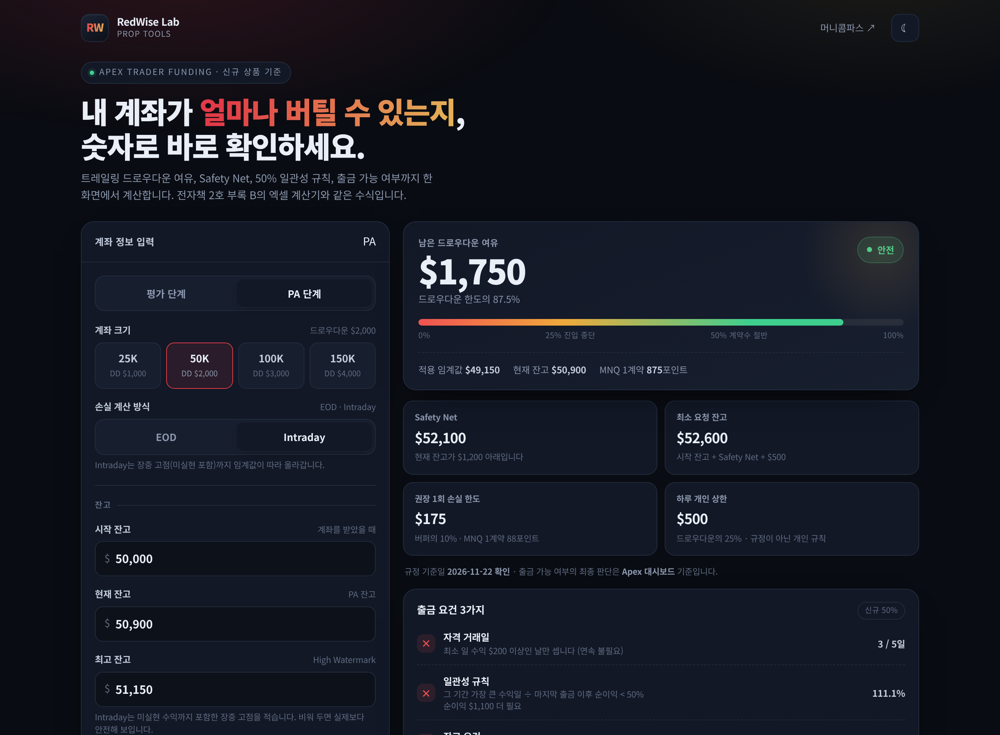

# Apex 프랍 룰 계산기 (MVP 프로토타입)

**라이브: https://inhyeokoh03.github.io/apex-rule-calculator/**

[](https://inhyeokoh03.github.io/apex-rule-calculator/)

RedWise Lab 사이드 프로젝트 ③ — Apex Trader Funding 신규 상품(EOD·Intraday) 계좌의
트레일링 드로우다운 여유, Safety Net, 일관성 규칙, 출금 가능 여부를 한 화면에서 계산하는
**단일 파일 정적 웹앱**입니다. 전자책 2호 『해외선물 프랍펌 규정과 리스크관리 실전매뉴얼』
부록 B의 엑셀 계산기와 같은 수식을 씁니다.

## 파일

| 경로 | 설명 |
|---|---|
| `index.html` | 앱 본체. HTML+CSS+JS 한 파일, 외부 의존성 0개(폰트·라이브러리 CDN 없음) |
| `tests/make_scenarios.py` | 엑셀 시나리오 5종 생성 + `formulas`로 엑셀 수식 재계산 |
| `tests/test_e2e.py` | headless Chromium으로 앱 화면을 조작해 엑셀 값·화면 표기와 대조 |
| `tests/test_i18n.py` | KO/EN 전환 검증 — 커밋본 대비 한국어 회귀, 영문 화면·메타, EN/KO 수치 동일, 토글 왕복, 레이아웃 |
| `en/index.html` | 영문 공유용 정적 엔트리 — 영문 OG 메타를 내려주고 `?lang=en`으로 넘김(계산기 본체는 `index.html` 하나) |
| `tests/shots.py` | PC(다크·라이트)·모바일(390px) 스크린샷 재생성 |
| `tests/excel_expected.json` | 엑셀 재계산 기준값 |
| `tests/app_actual.json` | 앱 화면 계산값 |
| `tests/검증결과표.md` | 항목별 대조표 (95/95 일치) |

## 로컬에서 열기

```bash
cd redwiselab/apex-rule-calculator
python3 -m http.server 8000     # → http://localhost:8000
```
`index.html`을 브라우저로 직접 열어도(file://) 동작합니다.

## 구현 범위

**입력**
- 단계: 평가 / PA
- 계좌 크기: 25K · 50K · 100K · 150K (신규 상품. 250K·300K는 레거시 전용이라 제외)
- 손실 방식: EOD / Intraday
- 시작 잔고 · 현재 잔고 · 최고 잔고(HWM) — Intraday는 `max(입력 HWM, 현재 잔고, 시작 잔고)`로 보정하고 보정 사실을 화면에 알림, EOD는 `max(입력 HWM, 시작 잔고)`만 적용하고 `HWM < 현재 잔고`면 경고
- PA: 마지막 출금 이후 순이익 · 그 기간 가장 큰 수익일 · 자격 거래일 · 출금 회차(1~6)
- PA 비활성 규정 안내(롤링 30일 내 순이익 $50 이상 2일)
- 일관성 기준: 신규 50% / 레거시 30%(참고용)

**출력**
- 적용 임계값 = clamp(최고 잔고 − DD, 시작−DD, 시작+100)
- 남은 여유($, %) · 신호등(안전/주의/경계/위험/계좌 종료) · MNQ 환산 포인트
- Safety Net(DD+100) · 최소 요청 잔고(시작+Safety Net+500) · 권장 1회 손실(여유의 10%) · 하루 개인 상한(DD의 25%)
- 출금 요건 3종 체크(자격 거래일 5일 · 일관성 <50% · 잔고 요건)과 부족분
- 일관성 비율과 **추가로 필요한 순이익**(가장 큰 수익일 ÷ 기준 − 순이익)
- 회차 상한 · Safety Net 초과분 · 실제 신청 가능 상한 · 남은 회차 · 6회 누적 상한
  - 출금 불가일 때는 상한을 `요건 충족 시 최대 $900`처럼 보조 표기(회색)로 보여 "지금 신청 가능"으로 오해하지 않게 함
- 다음 액션 가이드(막고 있는 요건 우선)
- 평가 단계: 목표 진행률, 목표까지 남은 금액, 플랫폼별 임계값 정지(Rithmic/WealthCharts vs Tradovate), EOD DLL

**UI**
- 다크/라이트 테마 토글(기본 다크, 선택은 브라우저에 저장)
- 입력값 `localStorage` 보관(서버 전송 없음)
- 390px 모바일 ~ 1360px 데스크톱 반응형, 모바일 하단 고정 요약 바
- 인쇄·스크린리더용 시맨틱 마크업(aria-pressed, aria-live, role=progressbar)

## 언어 (KO / EN)

- 상단 `KO | EN` 토글로 즉시 전환하며, 선택은 브라우저에 저장됩니다(기본 한국어).
- `?lang=en`으로 영문 링크를 그대로 공유할 수 있습니다 — https://inhyeokoh03.github.io/apex-rule-calculator/?lang=en
- 영문 화면에서는 `<html lang>`, `<title>`, description, OG 태그(`og:locale=en_US`, `og:url`)도 함께 영문으로 바뀝니다. 크롤러는 JS를 실행하지 않으므로, 레딧 등 미리보기용으로 영문 메타만 담은 정적 엔트리 `en/`를 함께 둡니다(사람은 `?lang=en`으로 이동).
- 계산 로직은 언어와 무관하게 동일한 함수·상수이며, 같은 입력에서 EN/KO 화면의 숫자가 완전히 같음을 테스트로 검증합니다(134 + 16항목).

## 배포

정적 파일 하나라 어디든 그대로 올라갑니다. 현재 GitHub Pages(`main` 브랜치 루트)로 서빙 중입니다.

**GitHub Pages** — https://inhyeokoh03.github.io/apex-rule-calculator/
1. `index.html`이 저장소 루트에 있음
2. Settings → Pages → Source: `Deploy from a branch` → `main` / `(root)`
3. 푸시 후 1~2분 내 반영

**Cloudflare Pages**
1. Workers & Pages → Create → Pages → Upload assets
2. 폴더(`index.html` 포함) 통째로 드래그 업로드 → 배포

도메인을 붙일 경우 `redwiselab.com/apex` 같은 경로로 연결하면 블로그·유튜브와 묶기 좋습니다.

## 검증

```bash
pip install openpyxl formulas playwright && playwright install chromium
python3 tests/make_scenarios.py     # 엑셀 재계산 → excel_expected.json
python3 tests/test_e2e.py           # 브라우저 대조 → PASS/FAIL
python3 tests/test_i18n.py          # KO/EN 전환 검증 → PASS/FAIL
python3 tests/shots.py              # screenshots/ 갱신
```

결과: 5개 시나리오 × 19항목 = **95/95**(엑셀 재계산값 ↔ 화면값), HWM 보정 케이스 21/21,
화면 문구 14/14, 모바일 4/4 → **총 134/134**. 상세는 `tests/검증결과표.md`.
추가로 KO/EN 전환 검증 `tests/test_i18n.py` **16/16**(한국어 회귀 10개 상태·영문 화면·메타·수치 동일·토글 왕복·레이아웃).
시나리오는 25K/50K/100K/150K × EOD/Intraday, 출금 이력 있음/없음, 일관성 정확히 50% 경계,
출금 가능/불가, HWM 보정(EOD·Intraday·공란) 케이스를 포함합니다.
95개 항목은 같은 규정 해석으로 만든 엑셀·웹앱 두 구현의 일치 확인이며, 규정 자체 대조는
Instinct 검수(2026-11-23)와 Apex 공식 문서로 별도 확인했습니다.

## 규정 기준

- 확인일: **2026-11-22** (2026-11-15 팩트체크와 동일 값)
- 출처: Apex 공식 Help Center · 제품 선택기, `downloads/ebook/2026-apex-rule-factcheck-2026-11-15.md`, `downloads/ebook/ebook2_apex/2026-apex-manual-final.md`
- 규정·가격은 예고 없이 바뀝니다. 계좌 구매·출금 신청 전 본인 대시보드 확인이 최종 기준입니다.

## 남은 일

- [x] Instinct 로직·UX 교차검증 회신 반영 (2026-11-23: HWM 보정 분리·상한 표기·라벨·비활성 규정·기준일)
- [x] GitHub Pages 배포 (2026-11-24, https://inhyeokoh03.github.io/apex-rule-calculator/)
- [x] KO/EN 전환 + `?lang=en` 공유 링크 (2026-11-24)
- [ ] (선택) 영문 OG 미리보기 이미지(og:image) — 영문 히어로 스크린샷을 `screenshots/`에 올린 뒤 연결
- [ ] (선택) Cloudflare Pages 배포
- [ ] 제휴 링크를 실제로 붙이는 시점에 링크 옆 제휴 고지 문구 추가(현재는 미래형 안내만)
- [ ] 크몽 전자책 2호 공개 후 CTA 링크 연결(현재 placeholder)
- [ ] 250K·300K(레거시) 규격 확인 시 확장
- [ ] (선택) 일별 기록 입력 → 엑셀 `기록` 시트처럼 세션 단위 버퍼 추이 그래프
